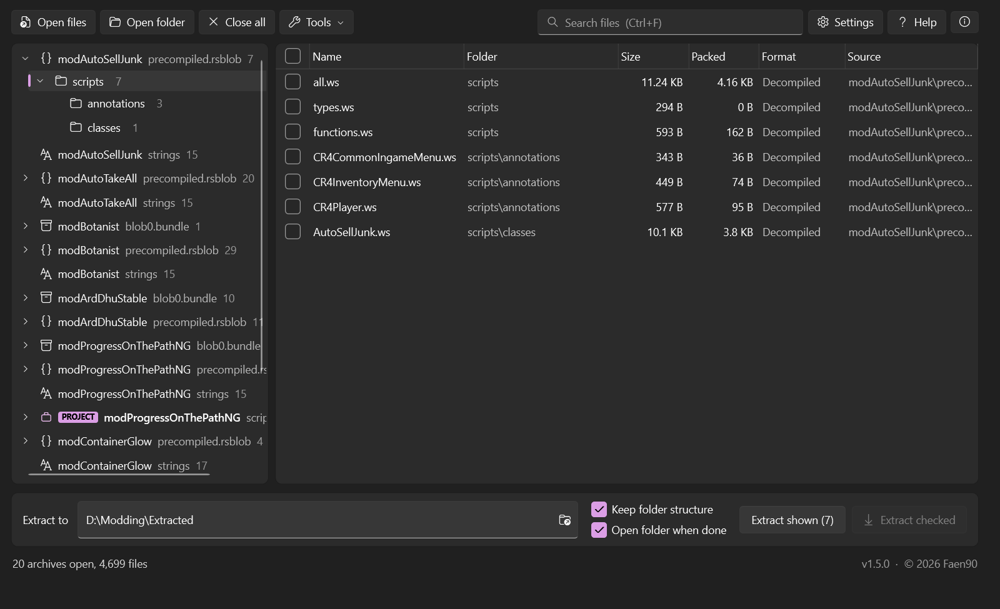
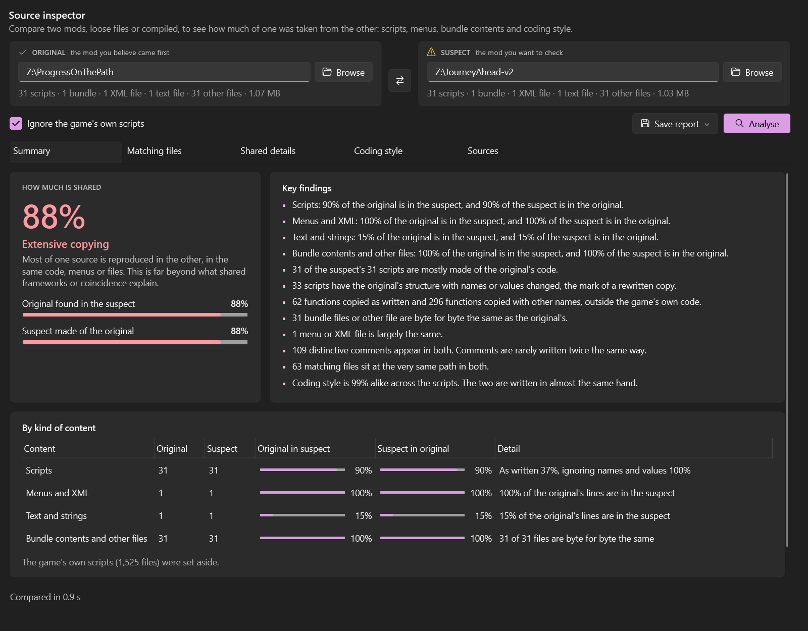
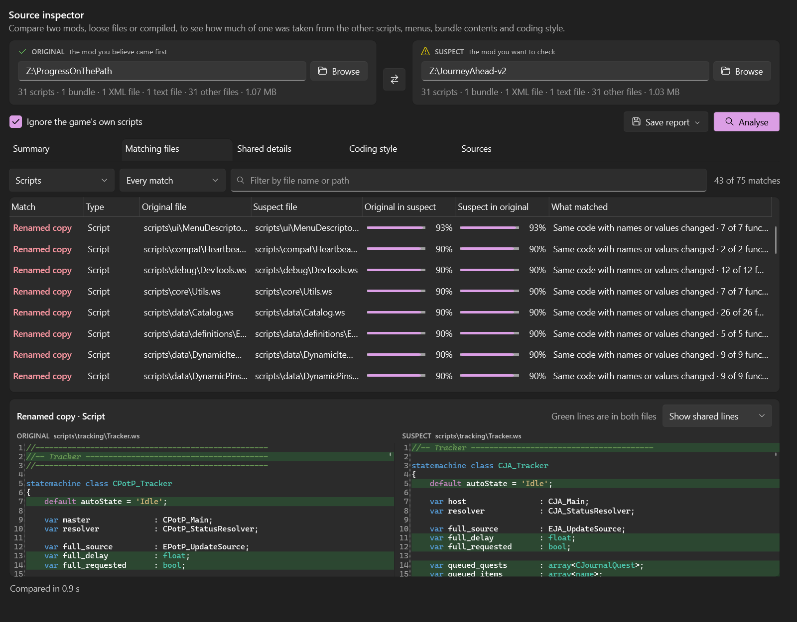
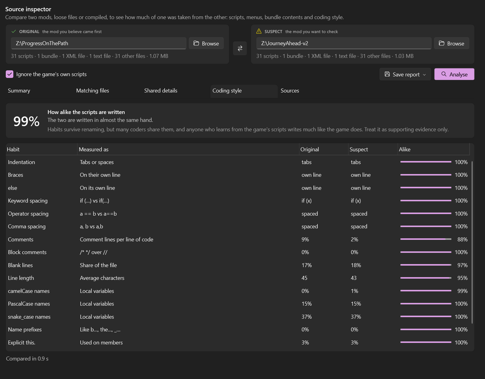
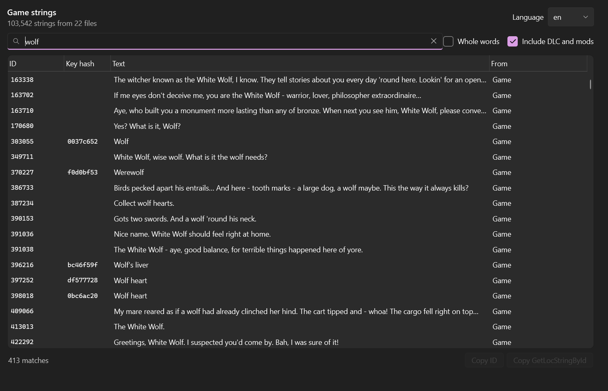
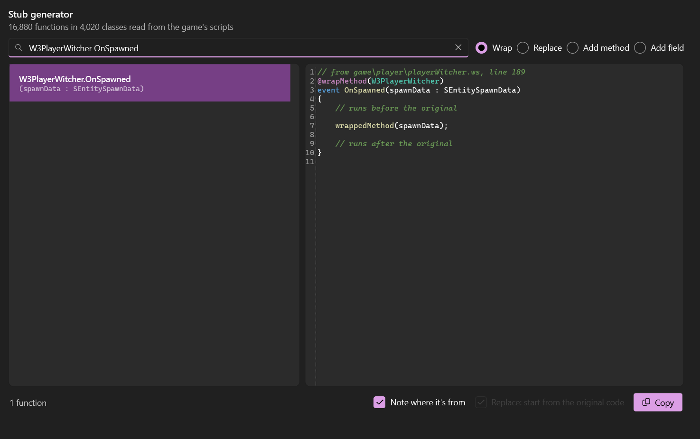
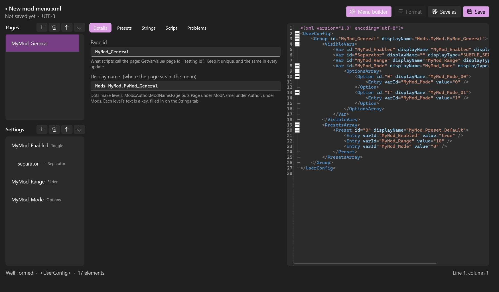
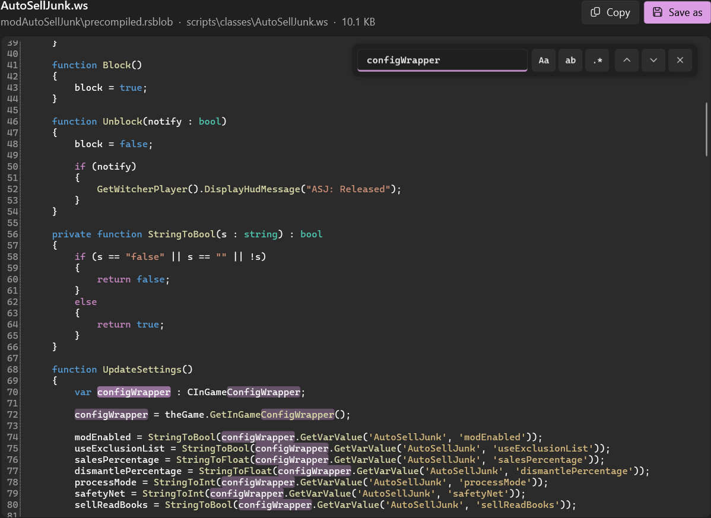
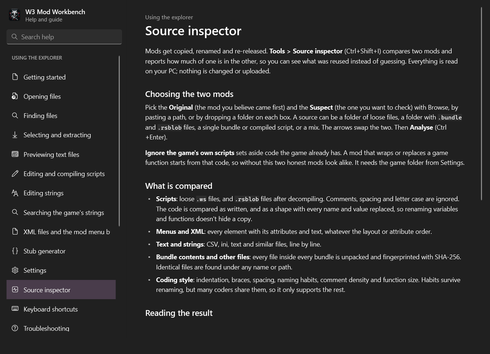
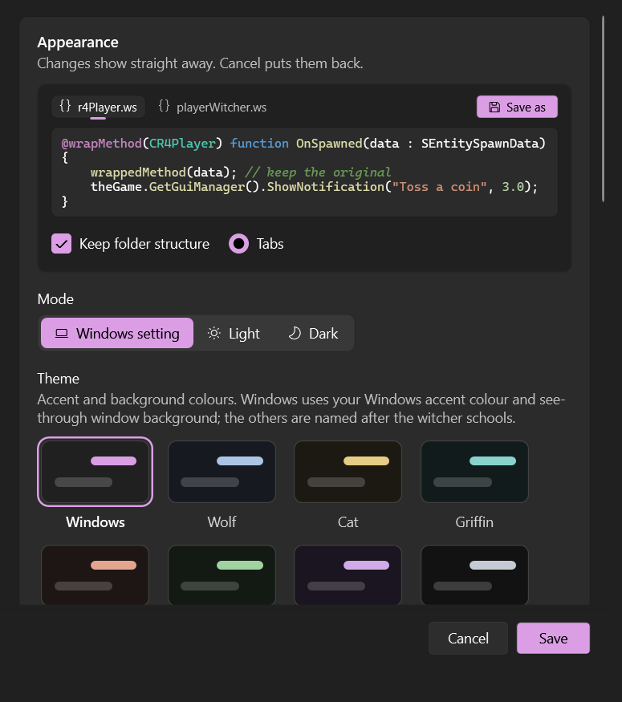

<div align="center">


# W3 Mod Workbench

[](https://github.com/Faen668/W3ModWorkbench/releases/latest)
[](https://github.com/Faen668/W3ModWorkbench/releases)
[](#-download)
[](https://dotnet.microsoft.com/)
[](https://www.thewitcher.com/)
[](LICENSE)
[](https://github.com/Faen668/W3ModWorkbench/commits)

**The all-in-one toolbox for The Witcher 3 modders.** Browse and extract `.bundle` archives, turn REDkit compiled scripts back into readable WitcherScript, edit and compile scripts, search the game's strings, build mod menus, generate wrap and replace stubs, and check whether a mod was copied from another.



</div>

---

## 🧭 What's inside

| | Tool | What it does |
|---|---|---|
| 📦 | **Bundle explorer** | Opens the whole game or any mod, browse, search and extract. |
| 🧩 | **Script decompiler** | `precompiled.rsblob` back into tidy, readable WitcherScript. |
| ✏️ | **Script editor** | Edit script projects with go to definition, an outline and highlighting, and compile with REDkit's own compiler. |
| 🔤 | **Strings** | Read and edit `.w3strings`, update translations in minutes, search every string the game has. |
| 🗂️ | **Mod menu builder** | Build `user_config_matrix` menus with forms, with the strings and the script that reads them. |
| 🪄 | **Stub generator** | Exact `@wrapMethod`, `@replaceMethod`, `@addMethod` and `@addField` code from the game's scripts. |
| 🕵️ | **Source inspector** | Compare two mods and see how much of one was copied from the other, even with everything renamed. |

## ✨ Features

### Bundles
- **Opens any `.bundle`**: the base game, expansions, DLC and mods. Supports both the current format (version 5, used since the next-gen update and by REDkit) and the older version 3, including the game's bundles over 4 GB.
- **Opens whole folders**: point it at `The Witcher 3\mods` and every installed mod is listed side by side, labelled by mod name rather than a sea of `blob0.bundle`.
- **Fast**: the entire game, about 365,000 files, loads in around a second.
- **Browse and search**: folder tree, sortable file list, and a search box that matches words anywhere in the path or wildcards on the file name (`*.redswf`, `*_icon??.xbm`).
- **Extract exactly what you need**: tick files across several archives at once, or extract everything shown, a single folder or a quick selection, with or without the original folder structure.
- **Handles every compression the game uses**: stored, zlib and LZ4 HC, plus LZ4 and Snappy.

### Compiled scripts
- **Decompiles `precompiled.rsblob`** back into WitcherScript, split into tidy `.ws` files:
  - one file per class, with its states,
  - the mod's enums and structs,
  - global and `exec` functions,
  - one file per game class the mod changes, holding its `@addField`, `@addMethod`, `@wrapMethod` and `@replaceMethod` code. That's handy for spotting conflicts between mods.
- **Reads like the original**: rebuilds `if` / `else if`, `for`, `while`, `do … while`, `switch`, `break` and `continue`. Keeps original names, types, defaults and hints, and shows every engine operator as its symbol.
- **Real enum names**: values are named from the mod's own enums and from the game's script sources, which the tool finds automatically.
- **Checked against real mods**: every decompiled function's size is verified against what the compiler recorded, and the output was compared line by line with the original source of several mods.

### Preview
- **Read text files without extracting**: decompiled scripts, plus `.xml`, `.csv`, `.ws`, `.json` and `.txt` files inside bundles.
- **WitcherScript syntax highlighting**, using the grammar from WebSpam's VS Code extension.
- **Line numbers and search** (Ctrl+F) with match case, whole word and regex, and F3 to jump between matches.
- **Go to definition**: Ctrl+click (or F12) any function, class, enum value or variable in a script to open where it's declared, in the same mod or in the game's own scripts. A `@wrapMethod` leads to the game's original, and calls the mod wraps offer both. Alt+Left goes back.
- **Definition popup**: rest the mouse on a name to see its declaration, highlighted, before you jump.
- **Tabs and split view**: files open as tabs (or separate windows, if you prefer), and `Ctrl+\` splits the preview to read two files, or two parts of one, side by side. Drag tabs between groups and windows.

### Script editor
- **Script projects**: open a folder of `.ws` files (a REDkit project's `workspace\scripts`, say) and edit its scripts with highlighting, go to definition and the definition popup, all following your edits. Unsaved files are marked and nothing closes without asking.
- **Edit decompiled mods**: *Edit as project* saves a compiled mod's decompiled scripts to a folder and opens them for editing.
- **Compile**: builds a project into a `.rsblob` with REDkit's own `wcc_lite.exe` (Ctrl+Shift+B), with its errors listed and linked to their lines. Needs REDkit, which is free for owners of the game; point Settings at `wcc_lite.exe` or let it find it.
- **Projects stand out**: script projects carry a **PROJECT** badge in the tree and beside the file name in the preview, so you can tell what you can edit from what's read-only.
- **Open in external editor**: right-click a text file or a preview tab to open it in your usual editor. A project's file opens itself; a file inside a bundle opens as a read-only copy.

### Strings
- **Read and edit `.w3strings` files**, or a strings `.csv`, and save them as `.w3strings` the game reads, optionally copied to every language, or export them as CSV. Key names come back from a strings CSV beside the file.
- **Update a translation in minutes**: when a mod updates, open its new strings and *Load translation* with the old one. Every string it already had is filled in, matched by key or ID, and only the new ones are left, marked **NEW**, with the original text beside them and a filter to show just those.

### Strings tools
- **Search the game's strings**: every string the game, its DLC and your installed mods would load, found by words in the text, an ID, or a key. Copy an ID or a ready-made `GetLocStringById(...)`. Reuse a line the game already has instead of writing a new one.
- **Check IDs**: finds IDs your strings share with the game or another mod, which would show each other's text in game, and suggests a free block of IDs.

### XML and mod menus
- **An XML editor** for any `.xml`, with syntax colouring, folding, a live well-formed check, Format, and encoding-safe saving (including UTF-16).
- **A mod menu builder** for `user_config_matrix` menus: pages, toggles, sliders, option lists, separators and presets, edited with forms while the XML is written beside them. It lists the text keys the menu needs and adds them to a strings CSV with fresh IDs, writes the WitcherScript that reads each setting, and checks for mistakes.

### Stub generator
- Pick a game function and get the `@wrapMethod` (with the right `wrappedMethod(...)` call), `@replaceMethod` (starting from the original code), `@addMethod` or `@addField` code, with its exact signature, from the game's own scripts. Also on a script's right-click menu.

### Source inspector
Tools > Source inspector (`Ctrl+Shift+I`) compares two mods and reports how much of one is in the other, so a re-upload or a rewritten copy can be told apart from honest overlap. Each source can be a folder of loose files, a folder of bundles and compiled scripts, or a mix.

- **Scripts are compared by their code, not their text.** Comments, spacing and letter case are ignored, and the code is also compared as a *shape* with every name and value replaced, so renamed variables, functions and classes still match. Compiled `.rsblob` files are decompiled first.
- **Menus and XML** are compared element by element, however the file is laid out; text and strings line by line.
- **Bundle contents** are unpacked and fingerprinted with SHA-256, so identical models, textures and data are found under any name or path.
- **Telltale details**: distinctive comments, messages, class and function names and menu keys found in both, functions copied whole, and functions copied with new names.
- **Coding style**: indentation, brace placement, spacing, naming habits, comment density and function size make a fingerprint that survives renaming.
- **Fair to honest mods**: the game's own scripts can be set aside, so two mods that wrap the same function aren't called copies.
- **Easy to read**: a verdict and key findings, a breakdown by kind of content, every matching file with a side-by-side view that marks the shared lines, and a report you can save as a web page or Markdown to share.

Similarity is evidence, not proof: mods for one game share its code and common frameworks. Read the matches before drawing a conclusion.

### Everything else
- **Light and dark modes**, or follow Windows, with eight colour themes: your Windows accent, one for each witcher school, and a plain Graphite.
- **A full built-in guide** (F1), including an Advanced section on the file formats and how the decompiler works.
- **Safe by default**: it never changes a bundle or a compiled script. Loose scripts are only written when you edit a script project and save.

## 📸 Screenshots

<div align="center">

**Source inspector**: how much was reused, and what



| Matching files, side by side | Coding style |
|:---:|:---:|
|  |  |

**Search the game's strings and generate stubs**

| Game strings | Stub generator |
|:---:|:---:|
|  |  |

**Mod menu builder**



**Decompiled scripts, with search and go to definition**



**Built-in guide and settings**

| Help | Settings |
|:---:|:---:|
|  |  |

</div>

## 📥 Download

1. Grab the latest `W3ModWorkbench-v<version>-win-x64.zip` from **[Releases](https://github.com/Faen668/W3ModWorkbench/releases/latest)**.
2. Unzip it anywhere.
3. Run `W3ModWorkbench.exe`.

No installer and nothing else to install: the release includes everything it needs, including .NET.

**Requirements:** Windows 10 or 11, 64-bit.

> **"Windows protected your PC"?** The exe isn't code-signed, so SmartScreen may warn the first few times. Click **More info**, then **Run anyway**.

## 🚀 Quick start

1. Click **Open files** or **Open folder**, or drag `.bundle` / `.rsblob` files or folders onto the window.
2. Pick a folder in the tree. The list shows everything inside it.
3. Tick the files you want, or search for them (Ctrl+F).
4. Set **Extract to**, then press **Extract checked** (Ctrl+E).

Double-click any text file or decompiled script to preview it. To edit scripts, open a folder of `.ws` files (or use **Edit as project** on a decompiled script), then **Ctrl+S** saves and **Ctrl+Shift+B** compiles. Press **F1** for the full guide.

| Shortcut | Action |
|---|---|
| `Ctrl+O` | Open files |
| `Ctrl+F` | Search |
| `Ctrl+E` | Extract checked files |
| `Space` | Tick or untick the highlighted rows |
| `Enter` | Preview the highlighted text file |
| `Ctrl+,` | Settings |
| `Ctrl+Shift+G` | Search the game's strings |
| `Ctrl+Shift+W` | Stub generator |
| `Ctrl+Shift+I` | Source inspector |
| `F1` | Help |

## 📝 About decompiled scripts

Compiled scripts keep names, types and logic, so the output is usually very close to what the author wrote. A few things are lost in compilation and can't be recovered:

- **Comments** are gone.
- **Formatting** is the tool's own.
- **Initialisers** like `var x : int = 0;` come back as a declaration plus a separate `x = 0;`.
- **Engine (C++) enums**, such as `EInventoryEventType`, have no script names, so their values show as a cast, e.g. `(EInventoryEventType)1`.

Decompiling is great for understanding how a mod works, checking two mods for compatibility, or recovering your own lost source. The code still belongs to its author, and their licence applies to it, so please don't republish other people's decompiled scripts as your own.

## 🛠️ Building from source

**You need:** Windows, and the [.NET 9 SDK](https://dotnet.microsoft.com/download/dotnet/9.0) or Visual Studio 2022 17.12 or newer.

Open `W3ModWorkbench.sln` in Visual Studio and press F5, or build from a terminal:

```bash
dotnet build W3ModWorkbench.sln -c Release
```

The only NuGet package is [AvalonEdit](https://github.com/icsharpcode/AvalonEdit), and it restores automatically.

**Making a release:** run `create-release.bat`. It publishes a self-contained single-file exe and packs it with the licence, notices, readme and changelog into `release\W3ModWorkbench-v<version>-win-x64.zip`. The version comes from `<Version>` in `W3ModWorkbench.csproj`. Visual Studio's **Publish** button uses the same `Release-win-x64` profile.

<details>
<summary><b>Project layout</b></summary>

| Folder | What's in it |
|---|---|
| `Core/` | Bundle reader, LZ4 and Snappy decoders, extraction, game folder detection |
| `Core/Scripts/` | The `.rsblob` reader, bytecode decoder, operator table, decompiler and WitcherScript writer; script projects and the wcc_lite compile runner |
| `Core/Inspector/` | The source inspector: scanner, script and XML analysers, matching and scoring, coding style, and the report writer |
| `Core/Strings/` | The .w3strings reader and writer, and the index of the game's strings |
| `Core/Menu/` | The mod menu model: reading and writing the XML, checks, keys and script |
| `Highlighting/` | WebSpam's WitcherScript grammar, and the XML colouring |
| `Help/` | The in-app guide (`HelpContent.cs` holds the text) |
| `ViewModels/` | The tree and list items behind the main window |

</details>

## 🙏 Credits

- **[WebSpam](https://github.com/webspam)**: the WitcherScript syntax highlighting comes from his VS Code extension, [witcherscript-vscode](https://github.com/webspam/witcherscript-vscode), used with his permission. Well worth installing if you write WitcherScript in VS Code.
- **[Aelto](https://github.com/Aelto)**: his decompiler project [tw3-cahirb](https://github.com/Aelto/tw3-cahirb) filled real gaps in this one. That covers the full list of the engine's built-in operators, several rarely used instructions, and a test blob from an older REDkit build. No code was copied, only facts about the format.
- **[AvalonEdit](https://github.com/icsharpcode/AvalonEdit)** by the SharpDevelop team: the code view in the preview window.

Licence texts for the third-party parts are in [THIRD-PARTY-NOTICES.md](THIRD-PARTY-NOTICES.md).

## 🤖 How it was made

W3 Mod Workbench was developed with AI assistance (Claude, by Anthropic), most of all in reverse-engineering the undocumented `.rsblob` format and building the decompiler. Nothing was taken on trust: the format work was checked against mods whose original source was available, and every decompiled function's size is verified against what the compiler recorded.

## 📄 Licence

Released under the [MIT Licence](LICENSE). Copyright © 2026 Faen90.

## ⚠️ Disclaimer

W3 Mod Workbench is an unofficial fan-made tool. It is not affiliated with, endorsed by or supported by CD PROJEKT RED. The Witcher, REDkit and REDengine are trademarks of CD PROJEKT S.A., used here only to describe what the tool works with.

<div align="center">
<sub>Developed by Faen90</sub>
</div>
