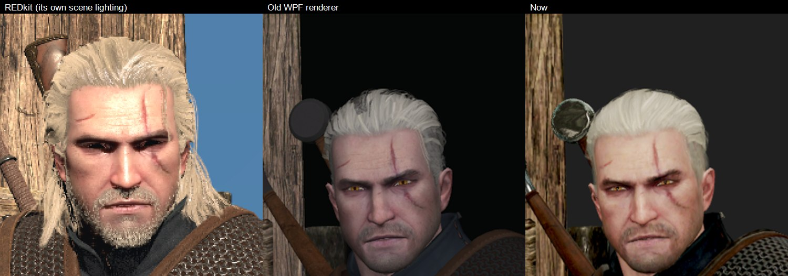
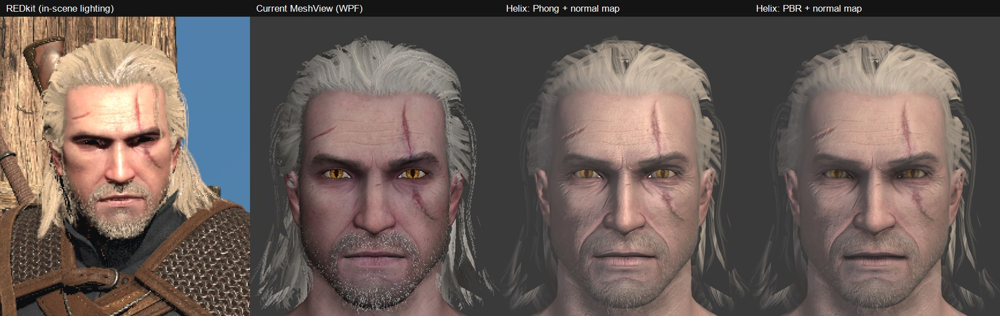
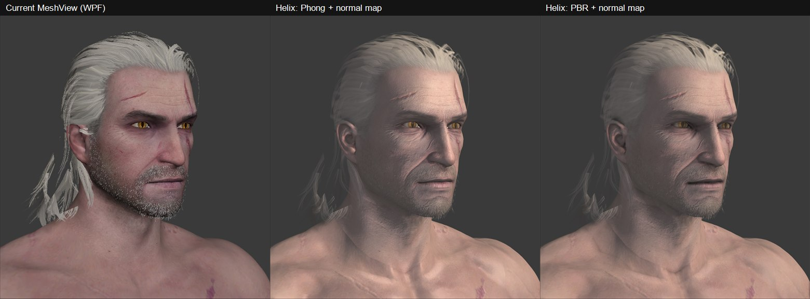
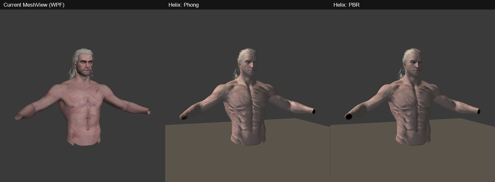

# The 3D renderer

Every 3D view in the workbench is a `MeshView` (`W3ModWorkbench/Controls/MeshView.cs`): the mesh viewer, the entity
viewer, the cutscene and scene stages and the preview pane. It used to draw with WPF's own `Viewport3D`, which can
only light per vertex and has no normal maps, specular, alpha blending or custom shaders. Characters looked smoother
and younger than in REDkit, and posing a big cast was slow. It now draws with
[Helix Toolkit](https://github.com/helix-toolkit/helix-toolkit)'s Direct3D 11 viewport for WPF,
`HelixToolkit.Wpf.SharpDX` 3.1.2 (MIT), with a pixel shader of its own that lights the game's materials as the game's
own shaders read them.

## How it's put together

- **One `Viewport3DX` per view, one `DefaultEffectsManager` for all of them** (the graphics device and shaders are
  made once). The viewport takes no mouse input: MeshView turns, pans and zooms its own camera as it always has.
- **Each chunk is a `MeshGeometryModel3D`**, drawn on both sides. Its geometry shares the chunk's UVs and triangles,
  made once, and has its own positions, normals and tangents, so each can be posed separately.
- **The view's own pixel shader** (`Rendering/Shaders/psW3Mesh.hlsl`, set up by `Rendering/W3Shading.cs`). It's built
  on Helix's shader library (its constant buffers, lights, shadow map and SSAO), compiled when the first view is made
  (SharpDX's D3DCompiler) and added to Helix's mesh technique as two passes of its own: `W3Mesh` for solid surfaces and
  `W3MeshOIT` for Helix's weighted transparent pass. `W3MaterialCore` makes a material draw with them, and
  `W3MaterialVariables` binds what the game's material needs beside Helix's own after Helix has bound the pass, just
  before each draw: a constant buffer (`cbW3`, b10) and textures from t40 on (normal map with its alpha, tint mask or
  packed skin map, two detail maps, hair's shift or a specular texture, the environment cube map, an eye's highlight
  cube map, and what glows).
- **What each material reads** was traced from REDkit's material graphs (`r4data\engine\materials\graphs`), by
  following each texture's sampler through the graph to the output block (`LookTextures.LookOf` builds a
  `MaterialLook` for each material):
  - **pbr_std and its variants:** roughness is the normal map's alpha; specularity is
    `SpecularColor × ((1 − roughness) × RSpecScale + RSpecBase)`; the colour is drawn toward `VarianceColor`
    (`customColoring`, pbr_std, pbr_spec and pbr_det only).
  - **Tint mask variants** (`pbr_std_tint_mask_det`, `_2det`, `_fresnel`): the tint mask's **red** is baked ambient
    occlusion (`AOPower` or `AmbientPower`), **green** the dye mask (the colour shift, done as before), **blue** where
    the detail normal maps go: one detail map where blue is over 0.55, or with two, the first above half and the
    second below. The detail map's alpha nudges roughness and darkens the colour a little (`DetailAlbedoPower`),
    fading out over `DetailRange` metres. Roughness is then remapped between `Roughness_min` and `Roughness_max`.
  - **pbr_skin:** the texture it calls **Ambient** isn't ambient occlusion but a packed map. Its red is where the
    tiled `DetailNormal` (pores) goes, green the roughness (plus `RoughnessBias`), blue the specularity
    (× `RSpecScale` + `RSpecBase`). The pores are blended with the graph's own reoriented blend. Skin takes the light
    a little past the edge (wrapped diffuse), warm where it wraps, as light under the skin does.
  - **pbr_spec:** the specular colour from its `SpecularTexture`.
  - **pbr_hair:** drawn as the game draws it, in two passes: alpha tested first (solid where the alpha is over half,
    writing depth), then the same cards blended in the transparent pass, so strands' thin ends fade softly. Its
    highlight runs along the strands (Kajiya-Kay), shifted by its `SpecularShiftTexture`. The colour is the texture
    (a neutral grey for beards) times the **vertex colour**, dark at the roots and light at the tips, which the shader
    takes from each vertex. It's read as a colour on screen is, turned into linear light first: read as it is, the
    Baron's beard came out white and his eyebrows light grey, where REDkit draws them grey-brown and dark (checked side
    by side against REDkit's `q103_27_baron_final_talk`). Geralt's `pbr_hair_new`, cooked without its graph, keeps
    masks in its vertex colours (mostly green), so it isn't multiplied by them.
  - **pbr_hair_simple** (a beard's dense inner layer) is a plain deferred surface in its graph, not hair: no highlight
    along the strands, roughness the normal map's alpha between `RoughMin` and `RoughMax`, specularity from
    `SpecShiftRInt_1` to `_2` as the alpha falls (times the shift texture's red, taken as a half), its colour times
    `DiffuseMul`, alpha tested at its alpha plus `MaskAdd`.
  - **pbr_eye:** its `Specularity`, `Roughness`, the corner flesh's `SpecularityMeat`, and a wet highlight from its
    own `BlickCube` cube map.
  - **transparent_lit / transparent_reflective** (glass, a monocle's lens): drawn in the transparent pass at the
    material's `Opacity`, plus what it reflects.
  - **Emissive:** `pbr_std_tint_mask_det_emissive` glows with its colour times its `emissive` texture times
    `emissive_multiplier` (a cave troll's lava); a colour times an `emissive_mask` glows where the mask says. The
    dissolve shaders' glow is driven by the game as they play, so it's left at rest.
- **Lighting** is done in linear light: GGX for the shine (Smith visibility, Schlick Fresnel), the diffuse wrapped
  for skin, then tone mapped (ACES, Narkowicz's fit) and graded (exposure, saturation, contrast) for the screen.
- **Image-based light:** the light all round and reflections come from an environment cube map, the game's own:
  Toussaint's forest probe (`dlc\bob\data\fx\textures\cubemap\bob_forest_cube.w2cube`), read once in the background
  (`W3Environment`). The light all round is its blurriest mip level in the direction of the surface's normal;
  reflections are a mip level by roughness in the direction of the reflection, weighted by Karis's fit of the
  environment BRDF. Only a third of its colour is kept, or everything would come out green. The cube's faces are in
  the game's Z-up space; the shader turns the view's Y-up directions into it.
- **Shadows:** `IsShadowMappingEnabled` and a 4096² `ShadowMap3D` covering the scene, made from the first
  directional light, the headlight behind the camera. It shades only that light, so what's in shadow keeps the light
  from all round. Hair doesn't cast shadows, as the shadow map would draw its cards as solid sheets.
- **Ambient occlusion:** Helix's SSAO darkens the light all round and the reflections in creases and corners.
- **Textures** go to the graphics card through `Services/GpuTextures.cs`. A texture read unchanged from a cache
  (`MeshTextures`) goes as its stored blocks, BC1, BC3, BC4, BC5, BC7 or RGBA8 with the game's own mip levels, from
  the level the viewer asked for: a quarter to an eighth of the memory, and the alpha kept (a normal map's
  roughness). A recoloured picture (dyes, hair's colour, a face's stubble) goes as 32-bit colour with mip levels made
  here (colour weighted by alpha, and a level's alpha halfway between the average and the most of the four pixels
  under it, so thin strands don't fade away from afar). The shader works out a normal map's blue itself, as BC5 maps
  keep only red and green. Cube maps go whole, as `Dds.Wrap` writes them.
- **Normal maps need tangents.** The game keeps them in the mesh, after each normal (10:10:10, with the handedness in
  the top two bits); REDkit's loose meshes keep them at byte 64 of their 152-byte vertex, the binormal at 76 (both
  checked against tangents worked out from the UVs: the same on 94 to 99% of vertices). `MeshFile` reads them, and a
  posed vertex's tangent is turned as far as its normal has turned, so a head and body that meet keep the same
  tangents along the seam. A mesh without them has them worked out from its UVs.
- **Faces' stubble** (`pbr_skin_decal`) is the material's `Decal` texture, mid-grey in the face's own UVs and darker
  where the hair is, laid over the skin texture as an overlay.
- **Morphed meshes** (`CMorphedMeshComponent`, 146 of the game's entities: sirens, alghouls, Chappelle's face) are
  drawn as the mesh they morph from (`morphSource`), as the game shows them until a quest or script morphs them;
  before, they weren't drawn at all.
- **The engine's default material** (`engine\materials\defaults\mesh.w2mg`, plain grey) on a chunk nobody gave
  a material (one under Yennefer's gown) is left out, as the shadow over the eyes is.
- **Neck transitions** use the engine's grey placeholder texture, which isn't in any texture cache, tinted by the
  material's `VarianceColor`; it's made here so they're skin-coloured, not grey.
- **Posing** hands each chunk new positions, normals and tangents (`UpdateVertices`) instead of building new WPF
  geometry. With 207,000 vertices posed every frame it kept 60 frames a second where WPF managed 26.
- **LOD by distance** (`AutoLod`, on in the scene and cutscene stages): each mesh is drawn at the LOD the game would
  draw it at from where the camera is, from its LOD distances (a distance of 0 past the first means not by
  distance). Checked at most twice a second; a pose that finishes after the view was rebuilt for another LOD poses
  the new chunks too.
- **Lines** (the floor grid, bounds, normals, bones, collision) are `LineGeometryModel3D`s, a fixed number of pixels
  wide. Wireframe is Helix's own, drawn over each chunk.
- **Cameras:** Helix's field of view is up the height, as the game's cameras are, so `LookThrough` passes the
  game's angle straight through. The free camera's `FieldOfView` still means across the width, as the viewers'
  sliders give it, and is converted for the view's shape.
- **Scene lights** (`SetLights`) still take WPF `PointLight`/`SpotLight`/`DirectionalLight`/`AmbientLight`s, so the
  callers didn't change. They're turned into Helix's lights with the same range and attenuation.
- **Background:** the windows' Mica backdrop doesn't show through Direct3D's picture, so the view is cleared to the
  theme's `SolidBackgroundFillColorBaseBrush` and follows the theme.
- **Hit testing** (`PartClicked`) uses Helix's `FindNearest`, which also returns the model clicked.

WPF overlays (subtitles, fades, notes, the loading panel) still draw over the view. Viewport3DX renders through a
D3DImage by default, which composes like any other WPF element. Swap-chain rendering would have airspace problems.

## Not done

- **Cloth isn't simulated.** Gowns, coats and capes hang in the shape they were made in, following their bones.
  The grey strip down the front of Yennefer's gown is a real trim in her dress texture, its triangles facing out at
  the front of the skirt; the game's cloth simulation may hang it differently.
- **Levels and particles.** Scenes and cutscenes play on an empty floor, without fire, smoke or magic.
- **Bloom and depth of field.** Each needs a full-screen pass that reads Helix's depth buffer, which its post-effect
  system doesn't give access to. The colour grade is done in the shader's tone mapping instead.
- **The scene's own environment.** Every view is lit by the same daylight probe; a scene or quest's environment
  definition (its sun, sky and probes) isn't read.
- **Scene lights don't cast shadows**; only the headlight does (Helix keeps one shadow map).
- **Morph blending.** Morphed meshes show their source mesh; the morph ratio and the morph materials' second
  texture set (`pbr_skin_morph`, `pbr_std_morph`) only matter while a quest drives them.
- **Eyes' refraction.** The game's eye shader bends the iris by the cornea (`TexcoordRaytrace`); the iris is drawn
  flat here.

## The prototype's comparison

Before the port, a prototype drew Geralt's head, hair and torso both ways, beside REDkit's cutscene editor:

